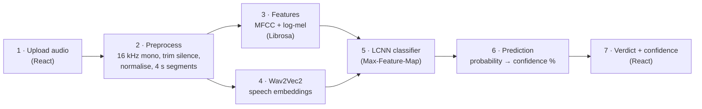

# FakeAudio Shield

**AI-Generated Voice & Deepfake Audio Detection System**

A web tool that checks whether a voice recording is likely genuine human speech or
AI-generated. Upload an audio file and get **Real / Bona-fide** or
**AI-generated / Spoof**, with a confidence score.

> Major Project · B.E. Computer Science & Engineering · 2025–26
> University B.D.T College of Engineering, Davangere (VTU, Belagavi)

---

## How it works



Steps 1 and 7 run in the React web page. Steps 2–6 run in the FastAPI backend (Python, PyTorch).

- **Wav2Vec2**: a speech model pre-trained on unlabelled audio. It turns the waveform into
  768 numbers per 20 ms frame. Layer 6 of `facebook/wav2vec2-base` is used.
- **Spectral features**: 80 log-mel and 20 MFCC values per frame from Librosa, aligned to the
  same 20 ms frames.
- **LCNN**: the classic ASVspoof countermeasure network. It reads the combined
  (time × features) map and outputs two probabilities: bona-fide and spoof.
- Long clips are split into 4 s segments, and their spoof probabilities are averaged.

## Project structure

```
backend/
  app/
    config.py        shared preprocessing, upload, and CORS settings
    preprocess.py    load, resample, trim, normalise, segment, invalid-audio checks
    features.py      Wav2Vec2 embeddings + MFCC/log-mel
    model.py         LCNN classifier
    inference.py     full pipeline for one file
    main.py          FastAPI app: GET /api/health, POST /api/predict
  train.py                   trains the LCNN and reports EER
  fetch_asvspoof_subset.py   downloads a balanced ASVspoof 2019 LA subset
  requirements.txt
frontend/                    React (Vite) user interface
```

## Setup (Windows)

Requirements: Python 3.11+, Node.js 18+, and `ffmpeg` on PATH (needed for M4A files).

Create the backend environment:

```powershell
cd backend
python -m venv .venv
.venv\Scripts\Activate.ps1
python -m pip install --upgrade pip
python -m pip install -r requirements.txt
```

Install the frontend dependencies:

```powershell
cd frontend
npm install
```

## Train the model

The trained checkpoint is generated locally and is not included in the repo. The current
pipeline supports English ASVspoof 2019 LA data and optional Indian-language Kathbath
real speech plus IndicSynth generated speech.

Download the English subset:

```powershell
cd backend
.venv\Scripts\Activate.ps1
python fetch_asvspoof_subset.py --out ..\data\LA
```

For the Indian-language real-speech download, accept the Kathbath dataset terms on Hugging
Face and authenticate with `hf auth login`. Then run the downloads as needed:

```powershell
python fetch_indic_subset.py --out ..\data\indic --kind fake
python fetch_indic_subset.py --out ..\data\indic --kind real
```

Both downloaders resume through their manifests. Train using both roots:

```powershell
python train.py --asvspoof-root ..\data\LA --indic-root ..\data\indic
```

`train.py` caches Wav2Vec2 and spectral features under `data/cache`, selects the best epoch
on the dev split, reports EER and accuracy, and writes
`backend/checkpoints/fakeaudio_lcnn.pt`. A missing data source is skipped by the training
script.

## Run

Terminal 1 (backend):

```powershell
cd backend
.venv\Scripts\Activate.ps1
python -m uvicorn app.main:app --host 127.0.0.1 --port 8000
```

Terminal 2 (frontend):

```powershell
cd frontend
npm run dev
```

Open http://localhost:5173. The Vite development server forwards `/api` requests to the
FastAPI server on port 8000.

For a frontend hosted on another origin, set a comma-separated list before starting the
backend:

```powershell
$env:FAKEAUDIO_CORS_ORIGINS = "http://localhost:5173,https://example.com"
python -m uvicorn app.main:app --host 127.0.0.1 --port 8000
```

## API

| Method | Path | Description |
|---|---|---|
| GET | `/api/health` | Whether the model is loaded, plus its measured dev/eval EER |
| POST | `/api/predict` | Multipart field `file` (WAV, FLAC, MP3, OGG or M4A, ≤ 20 MB) |

Example response:

```json
{
  "label": "spoof",
  "verdict": "AI-generated / Spoof",
  "confidence": 0.94,
  "probabilities": { "bonafide": 0.06, "spoof": 0.94 },
  "segments": [{ "start": 0.0, "end": 3.1, "spoof_probability": 0.94 }],
  "audio": { "filename": "clip.wav", "original_sample_rate": 44100,
             "original_duration_sec": 3.6, "analysed_duration_sec": 3.1,
             "processed_sample_rate": 16000 },
  "processing_time_ms": 850
}
```

Errors return `{"detail": "<message>"}` and the web page shows that message:

| Code | When |
|---|---|
| 400 | Empty, corrupted or unreadable file; silent audio; less than 0.5 s of speech |
| 413 | File larger than 20 MB |
| 415 | Unsupported file type |
| 503 | No trained model found. The API never returns a guessed result. |

## Datasets

| Dataset | Use | Status |
|---|---|---|
| ASVspoof 2019 LA | English training, dev and eval | Balanced subset downloader included |
| Kathbath | Indian-language bona-fide speech | Requires Hugging Face access; downloader included |
| IndicSynth | Indian-language generated speech | Downloader included |
| ASVspoof 2021 DF, WaveFake, in-the-wild audio | External testing | Planned |

## Current status and limitations

At the time of this README update, no trained checkpoint is committed. The API starts
without one, reports the state at `/api/health`, and returns HTTP 503 instead of guessing.

- **Wav2Vec2 is frozen, not fine-tuned.** Only the LCNN is trained to keep CPU training
  practical.
- **Subset training.** Metrics must be taken from `train.py` output; they are not target
  values and should be recorded for each language after training.
- Accuracy can fall for unseen voice-cloning systems, languages, codecs, noise, music, or
  telephone recordings.
- A confidence score is not a calibrated probability of fraud.
- Dataset licences and access terms must be checked before redistributing audio or models.

## Suggested improvements

1. Finish the multilingual downloads and record measured per-language EER and accuracy.
2. Add automated backend tests for audio validation, segmentation, checkpoint mismatch, and
   API status codes.
3. Add frontend tests for file validation, keyboard upload, loading states, and errors.
4. Calibrate the decision threshold on a held-out validation set instead of assuming `0.5`.
5. Add request IDs, structured logs, and a bounded worker queue before public deployment.
6. Evaluate on ASVspoof 2021 DF, WaveFake, and in-the-wild recordings.
7. Consider XLS-R or IndicWav2Vec after measuring the baseline; larger encoders increase CPU
   and memory requirements.

## Team

Anitha M · Madiha Naz · Mallikarjun M B ·
Manjunath G K

**Guide:** Prof. Naveen Kumar B, Department of CSE, UBDT College of Engineering, Davangere
