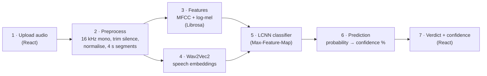

# FakeAudio Shield

**AI-Generated Voice & Deepfake Audio Detection System**

A web tool that checks whether a voice recording is likely genuine human speech or
AI-generated. Upload an audio file and get **Real / Bona-fide** or
**AI-generated / Spoof**, with a confidence score.

> Major Project · B.E. Computer Science & Engineering · 2025–26
> University B.D.T College of Engineering, Davangere (VTU, Belagavi)

---

## Quick start (demo)

A trained English model is included. On Windows, double-click `start-backend.bat`, wait
for `FakeAudio Shield: Model ready`, then double-click `start-frontend.bat`. See
[DEMO.md](DEMO.md) for what to show and how to explain it.

## How it works



Steps 1 and 7 run in the React web page. Steps 2–6 run in the FastAPI backend (Python, PyTorch).

- **Wav2Vec2**: a speech model pre-trained on unlabelled audio. It turns the waveform into
  768 numbers per 20 ms frame. Layer 6 of `facebook/wav2vec2-base` is used.
- **Spectral features**: 80 log-mel and 20 MFCC values per frame from Librosa, aligned to the
  same 20 ms frames.
- **LCNN**: the classic ASVspoof countermeasure network. It reads the combined
  (time × features) map and outputs two probabilities: bona-fide and spoof.
- Long clips are split into 4 s segments, and their spoof probabilities are averaged.

## Project structure

```
backend/
  app/
    config.py        shared preprocessing, upload, and CORS settings
    preprocess.py    load, resample, trim, normalise, segment, invalid-audio checks
    features.py      Wav2Vec2 embeddings + MFCC/log-mel
    model.py         LCNN classifier
    inference.py     full pipeline for one file
    main.py          FastAPI app: GET /api/health, POST /api/predict
  checkpoints/fakeaudio_lcnn.pt   trained English model (1.3 MB)
  train.py                   trains the LCNN and reports EER (overall and per language)
  evaluate.py                scores the saved model on the test split
  fetch_asvspoof_subset.py   downloads a balanced ASVspoof 2019 LA subset
  fetch_indic_subset.py      downloads Kathbath (real) + IndicSynth (fake) samples
  requirements.txt
frontend/                    React (Vite) website
  src/components/            Nav, Hero, Detector, Waveform, Results, Team, FAQ, … sections
  src/api.js                 calls to /api/health and /api/predict
  public/samples/            5 ASVspoof 2019 eval clips for the "try a sample" buttons (ODC-By)
start-backend.bat, start-frontend.bat   double-click launchers
DEMO.md                      demo script and plain-language explanation
PROGRESS.md                  progress notes and how to resume the multilingual work
```

## Setup (Windows)

Requirements: Python 3.11+, Node.js 18+, and `ffmpeg` on PATH (needed for M4A files).

Create the backend environment:

```powershell
cd backend
python -m venv .venv
.venv\Scripts\Activate.ps1
python -m pip install --upgrade pip
python -m pip install -r requirements.txt
```

Install the frontend dependencies:

```powershell
cd frontend
npm install
```

## Train the model

An English-only checkpoint is included (see [Measured results](#measured-results)), so
training is only needed to reproduce it or to add the Indian languages. The pipeline
supports English ASVspoof 2019 LA data and optional Indian-language Kathbath real speech
plus IndicSynth generated speech.

Download the English subset:

```powershell
cd backend
.venv\Scripts\Activate.ps1
python fetch_asvspoof_subset.py --out ..\data\LA
```

For the Indian-language real-speech download, accept the Kathbath dataset terms on Hugging
Face and authenticate with `hf auth login`. Then run the downloads as needed:

```powershell
python fetch_indic_subset.py --out ..\data\indic --kind fake
python fetch_indic_subset.py --out ..\data\indic --kind real
```

Both downloaders resume through their manifests. Train using both roots:

```powershell
python train.py --asvspoof-root ..\data\LA --indic-root ..\data\indic
```

`train.py` caches Wav2Vec2 and spectral features under `data/cache`, selects the best epoch
on the dev split, reports EER and accuracy, and writes
`backend/checkpoints/fakeaudio_lcnn.pt`. A missing data source is skipped by the training
script.

Useful options: `--languages English` trains on a subset of languages, and `--extract-only`
caches features without training (for example while downloads are still running). The
best model is saved after every improving epoch, so training can be stopped early. In
that case, run `python evaluate.py` to measure the saved model on the test split.

## Run

Terminal 1 (backend):

```powershell
cd backend
.venv\Scripts\Activate.ps1
python -m uvicorn app.main:app --host 127.0.0.1 --port 8000
```

Terminal 2 (frontend):

```powershell
cd frontend
npm run dev
```

Open http://localhost:5173. The Vite development server forwards `/api` requests to the
FastAPI server on port 8000.

For a frontend hosted on another origin, set a comma-separated list before starting the
backend:

```powershell
$env:FAKEAUDIO_CORS_ORIGINS = "http://localhost:5173,https://example.com"
python -m uvicorn app.main:app --host 127.0.0.1 --port 8000
```

## API

| Method | Path | Description |
|---|---|---|
| GET | `/api/health` | Whether the model is loaded, plus its measured dev/test EER |
| POST | `/api/predict` | Multipart field `file` (WAV, FLAC, MP3, OGG or M4A, ≤ 20 MB) |

Example response:

```json
{
  "label": "spoof",
  "verdict": "AI-generated / Spoof",
  "confidence": 0.94,
  "probabilities": { "bonafide": 0.06, "spoof": 0.94 },
  "segments": [{ "start": 0.0, "end": 3.1, "spoof_probability": 0.94 }],
  "audio": { "filename": "clip.wav", "original_sample_rate": 44100,
             "original_duration_sec": 3.6, "analysed_duration_sec": 3.1,
             "processed_sample_rate": 16000 },
  "processing_time_ms": 850
}
```

Errors return `{"detail": "<message>"}` and the web page shows that message:

| Code | When |
|---|---|
| 400 | Empty, corrupted or unreadable file; silent audio; less than 0.5 s of speech |
| 413 | File larger than 20 MB |
| 415 | Unsupported file type |
| 503 | No trained model found. The API never returns a guessed result. |

## Datasets

| Dataset | Use | Status |
|---|---|---|
| ASVspoof 2019 LA | English training, dev and eval | Balanced subset downloader included |
| Kathbath | Indian-language bona-fide speech | Requires Hugging Face access; downloader included |
| IndicSynth | Indian-language generated speech | Downloader included. The Hugging Face release contains only XTTS-v2 and FreeVC clips (no VITS, although the dataset card lists it). |
| ASVspoof 2021 DF, WaveFake, in-the-wild audio | External testing | Planned |

## Measured results

English-only model (`backend/checkpoints/fakeaudio_lcnn.pt`), trained on 2,500 ASVspoof
2019 LA clips (1,250 real + 1,250 fake, attacks A01–A06). Training was stopped after
epoch 3 (about 9–20 minutes per epoch on this CPU). The epoch was chosen on the dev set;
the test set was used once, afterwards.

| Split | Clips | EER | Accuracy at 0.5 | Real passed | Fake caught |
|---|---|---|---|---|---|
| Dev (attacks A01–A06, seen) | 800 | 2.00% | 95.0% | 396 / 400 | 364 / 400 |
| **Test (attacks A07–A19, never seen)** | 800 | **8.25%** | 81.4% | 399 / 400 | 252 / 400 |

Fake detection on the test set by attack type, at the 0.5 threshold:

| Attack | A07 | A08 | A09 | A10 | A11 | A12 | A13 | A14 | A15 | A16 | A17 | A18 | A19 |
|---|---|---|---|---|---|---|---|---|---|---|---|---|---|
| Caught | 39% | 90% | 84% | 16% | 45% | 65% | 100% | 48% | 45% | 65% | 93% | 70% | 60% |

**How to read this:** the model almost never calls real speech fake (399/400), but at
the default 0.5 threshold it misses about a third of the fakes made by generators it has
never seen. Some systems are caught almost always (A13, A17), others rarely (A10, a
Tacotron 2 + WaveRNN voice). The low EER shows the scores separate real from fake well;
the threshold is not yet calibrated for unseen attacks.

## Current status and limitations

The included checkpoint is **English-only**. The Indian-language pipeline is built, but
it is not trained yet: 1,313 of 2,100 IndicSynth fake clips are downloaded (Hindi, Kannada,
Tamil and Telugu complete, Malayalam 113/300), and the Kathbath real speech still needs Hugging Face access (see `PROGRESS.md`).
Without a checkpoint the API still starts, reports the state at `/api/health`, and returns
HTTP 503 instead of guessing.

- **Wav2Vec2 is frozen, not fine-tuned.** Only the LCNN is trained to keep CPU training
  practical.
- **Subset training.** 2,500 training clips and 3 epochs. The numbers above are measured,
  not targets; per-language numbers are recorded once the Indian languages are trained.
- Accuracy can fall for unseen voice-cloning systems, languages, codecs, noise, music, or
  telephone recordings.
- A confidence score is not a calibrated probability of fraud.
- Dataset licences and access terms must be checked before redistributing audio or models.

## Suggested improvements

1. Finish the multilingual downloads and record measured per-language EER and accuracy.
2. Add automated backend tests for audio validation, segmentation, checkpoint mismatch, and
   API status codes.
3. Add frontend tests for file validation, keyboard upload, loading states, and errors.
4. Calibrate the decision threshold on a held-out validation set instead of assuming `0.5`.
5. Add request IDs, structured logs, and a bounded worker queue before public deployment.
6. Evaluate on ASVspoof 2021 DF, WaveFake, and in-the-wild recordings.
7. Consider XLS-R or IndicWav2Vec after measuring the baseline; larger encoders increase CPU
   and memory requirements.

## Next project plan

The next milestone is to produce a measured multilingual baseline that teammates can run
from a clean checkout. Work through the phases in order so model quality is measured before
adding larger models or deployment complexity.

### Phase 1: Finish the data pipeline

- Accept the Kathbath terms and complete the real-speech download.
- Finish the IndicSynth download and confirm every requested language has a manifest entry.
- Check that train, dev, and test speakers do not overlap for Indian-language data.
- Keep downloaded audio and feature caches under `data/`; do not commit them.

### Phase 2: Train and record a baseline

```powershell
cd backend
.venv\Scripts\Activate.ps1
python train.py --asvspoof-root ..\data\LA --indic-root ..\data\indic
```

Record the following from the training output and checkpoint metadata:

- overall dev and test EER and accuracy;
- per-language EER and accuracy;
- number of clips, speakers, and generators in every split;
- training settings, runtime, and the checkpoint date.

The phase is complete when `backend/checkpoints/fakeaudio_lcnn.pt` exists and the API
reports `model_loaded: true` from `/api/health`.

### Phase 3: Validate the application

- Run the frontend and backend together with at least one real and one generated clip per
  available language.
- Test empty, silent, corrupt, unsupported, oversized, and very short uploads.
- Confirm that long recordings are capped at 60 seconds and that segment probabilities are
  displayed correctly.
- Add automated backend tests for preprocessing, checkpoint mismatch, and API status codes.
- Add frontend tests for file validation, keyboard upload, loading states, and errors.

### Phase 4: Improve reliability and generalisation

- Calibrate the decision threshold on a held-out validation set instead of assuming `0.5`.
- Add request IDs, structured logs, and a bounded inference queue before public deployment.
- Evaluate on ASVspoof 2021 DF, WaveFake, and in-the-wild recordings.
- Compare the measured baseline with XLS-R or IndicWav2Vec only if multilingual results
  justify the extra CPU and memory cost.

### Definition of release readiness

The project is ready for a supervised demonstration when a fresh setup can install the
dependencies, load the checkpoint, pass the validation cases above, show measured metrics
for each supported language, and clearly label every result as a prediction rather than proof
of authenticity.

## Team

Anitha M · Madiha Naz · Mallikarjun M B ·
Manjunath G K

**Guide:** Prof. Naveen Kumar B, Department of CSE, UBDT College of Engineering, Davangere
