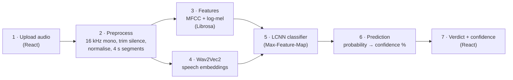

# FakeAudio Shield

**AI-Generated Voice & Deepfake Audio Detection System**

A web tool that checks whether a voice recording is likely genuine human speech or
AI-generated. Upload an audio file and get **Real / Bona-fide** or
**AI-generated / Spoof**, with a confidence score.

> Major Project · B.E. Computer Science & Engineering · 2025–26
> University B.D.T College of Engineering, Davangere (VTU, Belagavi)

---

## How it works



Steps 1 and 7 run in the React web page. Steps 2–6 run in the FastAPI backend (Python, PyTorch).

- **Wav2Vec2**: a speech model pre-trained on unlabelled audio. It turns the waveform into
  768 numbers per 20 ms frame. Layer 6 of `facebook/wav2vec2-base` is used.
- **Spectral features**: 80 log-mel and 20 MFCC values per frame from Librosa, aligned to the
  same 20 ms frames.
- **LCNN**: the classic ASVspoof countermeasure network. It reads the combined
  (time × features) map and outputs two probabilities: bona-fide and spoof.
- Long clips are split into 4 s segments, and their spoof probabilities are averaged.

## Project structure

```
backend/
  app/
    config.py        shared settings (sample rate, frame sizes, upload limits)
    preprocess.py    load, resample, trim, normalise, segment, invalid-audio checks
    features.py      Wav2Vec2 embeddings + MFCC/log-mel
    model.py         LCNN classifier
    inference.py     full pipeline for one file
    main.py          FastAPI app: GET /api/health, POST /api/predict
  train.py                   trains the LCNN and reports EER
  fetch_asvspoof_subset.py   downloads a balanced ASVspoof 2019 LA subset
  requirements.txt
frontend/                    React (Vite) user interface
```

## Setup (Windows)

Requirements: Python 3.11+, Node.js 18+, and `ffmpeg` on PATH (needed for M4A files).

```bash
cd backend
python -m venv .venv
.venv\Scripts\activate
pip install -r requirements.txt
```

```bash
cd frontend
npm install
```

## Train the model

The trained checkpoint is not included in the repo yet, so it must be trained first.

```bash
cd backend
.venv\Scripts\activate
python fetch_asvspoof_subset.py --out ..\data\LA
python train.py --data-root ..\data\LA
```

- `fetch_asvspoof_subset.py` downloads 2,500 train, 800 dev and 800 eval clips (~250 MB)
  from the official ASVspoof 2019 LA release on Edinburgh DataShare. It reads them from
  the remote ZIP, so the full 7 GB file is never downloaded.
- `train.py` caches the Wav2Vec2 features, trains the LCNN, picks the best epoch on the
  dev set, then tests on the eval set. The eval set uses attack types A07–A19, which the
  model never sees in training. It saves `backend/checkpoints/fakeaudio_lcnn.pt`, along
  with the measured EER and accuracy.

## Run

Terminal 1 (backend):

```bash
cd backend
.venv\Scripts\activate
uvicorn app.main:app --port 8000
```

Terminal 2 (frontend):

```bash
cd frontend
npm run dev
```

Open http://localhost:5173.

## API

| Method | Path | Description |
|---|---|---|
| GET | `/api/health` | Whether the model is loaded, plus its measured dev/eval EER |
| POST | `/api/predict` | Multipart field `file` (WAV, FLAC, MP3, OGG or M4A, ≤ 20 MB) |

Example response:

```json
{
  "label": "spoof",
  "verdict": "AI-generated / Spoof",
  "confidence": 0.94,
  "probabilities": { "bonafide": 0.06, "spoof": 0.94 },
  "segments": [{ "start": 0.0, "end": 3.1, "spoof_probability": 0.94 }],
  "audio": { "filename": "clip.wav", "original_sample_rate": 44100,
             "original_duration_sec": 3.6, "analysed_duration_sec": 3.1,
             "processed_sample_rate": 16000 },
  "processing_time_ms": 850
}
```

Errors return `{"detail": "<message>"}` and the web page shows that message:

| Code | When |
|---|---|
| 400 | Empty, corrupted or unreadable file; silent audio; less than 0.5 s of speech |
| 413 | File larger than 20 MB |
| 415 | Unsupported file type |
| 503 | No trained model found. The API never returns a guessed result. |

## Datasets

| Dataset | Use | Status |
|---|---|---|
| ASVspoof 2019 LA | Training, dev and eval | Used (balanced subset) |
| ASVspoof 2021 DF, WaveFake, In-the-Wild | Further testing | Planned, not yet used |

## Design notes and limitations

- **Wav2Vec2 is frozen, not fine-tuned.** Training runs on a CPU-only laptop, so Wav2Vec2
  is used as a fixed feature extractor and only the LCNN is trained.
- **Subset training.** The model is trained on 4,100 clips rather than the full ~100K
  utterances. Accuracy figures come from `train.py`'s measured EER, not from targets.
- Accuracy depends on the training data. New voice-cloning tools and recording conditions
  very different from ASVspoof (phone calls, noise, music) may reduce accuracy.
- **The output is a prediction, not proof of authenticity.**

## Team

Anitha M · Madiha Naz · Mallikarjun M B ·
Manjunath G K

**Guide:** Prof. Naveen Kumar B, Department of CSE, UBDT College of Engineering, Davangere
