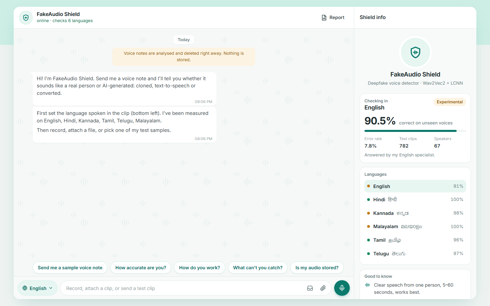
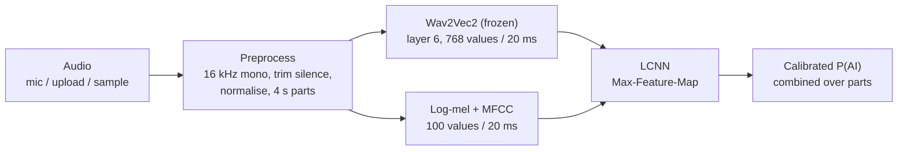

# FakeAudio Shield

**Detect AI-generated voices and audio deepfakes, with honest per-language results.**

Voice-clone scams usually arrive as a voice note. So FakeAudio Shield works like a chat: send
it a voice note (record, attach a file, or send one of its test clips) and it replies with a
verdict. Is the voice real or AI-generated (voice cloning, text-to-speech, voice conversion)?
How confident is it, and which part sounds most synthetic? It runs on an ordinary CPU.



## Supported languages and measured accuracy

Every language is evaluated separately on its own test set of **speakers the model never
heard**. For English, the test set also uses **13 voice generators never seen in training**.

<!-- results:start -->
_Generated by `backend/make_results_md.py` from the evaluation report (2026-10-19)._

| Language | Status | Model | Test EER (95% CI) | Accuracy | Test clips | Test speakers |
|---|---|---|---|---|---|---|
| English | **experimental** | English specialist | 7.8% (6.5–10.4%) | 90.5% | 782 | 67 |
| Hindi | **supported** | Multilingual | 0.0% (0.0–0.0%) | 100.0% | 100 | 20 |
| Kannada | **experimental** | Multilingual | 1.7% (0.0–11.7%) | 98.3% | 60 | 7 |
| Malayalam | **experimental** | Multilingual | 0.0% (0.0–0.0%) | 100.0% | 104 | 3 |
| Tamil | **supported** | Multilingual | 2.4% (0.0–6.1%) | 96.3% | 82 | 22 |
| Telugu | **supported** | Multilingual | 0.0% (0.0–0.0%) | 96.9% | 32 | 10 |

All languages together: 93.2% accuracy and 6.5% EER on 1,160 unseen test clips.
<!-- results:end -->

- **Supported** = upper 95% bound of test EER ≤ 10% **and** at least 10 different test speakers.
- **Experimental** = test EER ≤ 25%, but too few test speakers or too wide an interval to claim support.
- EER (equal error rate) is the point where real voices flagged as AI equal AI voices passed as real. Lower is better.
- Full breakdown (confidence intervals, per-attack rates, dataset audit, training details): [RESULTS.md](RESULTS.md)
  or the **Results** page in the app. Only these six languages are accepted by the API.

## Features

- **A chat, not a form:** record a voice note (with a live spectrogram while you speak), attach
  a file (WAV, FLAC, MP3, OGG, M4A, up to 20 MB) or drag it in, or send a "mystery" test clip.
  Whether a test clip is real or AI is revealed only after Shield answers.
- **Verdicts you can inspect:** a real-to-AI meter, the score of every 4-second part (tap one to
  hear it), and **Play the most AI-like part**, which jumps the voice note to the most suspicious stretch.
- **Shareable verdict card:** one tap creates an image (verdict, confidence, parts, language,
  model) for the system share sheet, or downloads it.
- **Language-aware:** the language chip picks the model (an English specialist, or the
  multilingual model). Shield tells you how reliable it is for that language.
- **Honest answers:** ask "How accurate are you?" or "What can't you catch?". The answers come
  from the live evaluation report. The **Report** screen has per-language metrics with 95%
  confidence intervals, a recording-condition check, the dataset audit and licences.
- **Lightweight:** a frozen pretrained speech model plus small classifiers (about 0.3 M trainable
  parameters each). No GPU needed for inference or training.

## Quick start

Prerequisites: **Python 3.13** (the tested version), **Node.js 20.19+**, and **ffmpeg** on `PATH` (only needed
for M4A uploads). On first start the backend downloads `facebook/wav2vec2-base` (~360 MB)
from Hugging Face; after that it works offline.

```bash
git clone <your-fork-url> fakeaudio-shield
cd fakeaudio-shield

# backend (API + model)
cd backend
python -m venv .venv
# Windows: .venv\Scripts\activate      macOS/Linux: source .venv/bin/activate
pip install -r requirements.txt
uvicorn app.main:app --port 8000        # wait for "FakeAudio Shield: Model ready"

# frontend (second terminal)
cd frontend
npm ci
npm run dev                              # http://localhost:5173
```

On Windows you can also double-click `start-backend.bat`, then `start-frontend.bat`.

The trained models are included in `backend/checkpoints/`, so no training is needed. The
microphone only works on `localhost` or over HTTPS (a browser security rule).

## Deployment

The backend serves the built website itself, so production is a single process.

```bash
cd frontend && npm ci && npm run build          # creates frontend/dist
cd ../backend && uvicorn app.main:app --host 0.0.0.0 --port 8000
# -> website and API on http://<host>:8000
```

Or with Docker:

```bash
docker build -t fakeaudio-shield .
docker run --rm -p 8000:8000 fakeaudio-shield
```

The image bundles the website, the models and the Wav2Vec2 weights, runs as a non-root
user and has a health check on `/api/health`. *The Dockerfile has not been built and
tested yet; the single-process setup above has been. Please open an issue if the image
build fails.*

Configuration (all optional, see [.env.example](.env.example)):

| Variable | Read by | Purpose |
|---|---|---|
| `FAKEAUDIO_CORS_ORIGINS` | backend | Comma-separated origins allowed to call the API from another origin |
| `FAKEAUDIO_FRONTEND_DIST` | backend | Folder of the built website (default `frontend/dist`) |
| `VITE_API_BASE` | frontend build | API URL when the website is hosted separately from the API |

Production notes:
- Put it behind a reverse proxy with **HTTPS** (needed for the microphone) and set the
  proxy's request-body limit to at least 20 MB.
- Use **one worker per process**: each loads the models (measured: ~0.5 GB working set,
  ~1.4 GB committed memory; plan for 1.5 GB). Scale with more processes or containers.
- Measured on a laptop CPU: about 1.8 s per 10-second clip; the first request after start
  takes about 6 s (warm-up).
- The API has no authentication or rate limiting. Add them at the proxy if it is public.

## API

| Method | Path | Description |
|---|---|---|
| `GET` | `/api/health` | Model status, evaluated languages, which language uses which model |
| `GET` | `/api/report` | Full evaluation report (per-language metrics, dataset, training) |
| `GET` | `/api/data-size-study` | Learning curve: EER against number of training clips |
| `POST` | `/api/predict` | Multipart form: `file` (required), `language` (optional, one of the evaluated languages) |

```bash
curl -F "file=@clip.wav" -F "language=Hindi" http://localhost:8000/api/predict
```

```json
{
  "label": "spoof", "verdict": "AI-generated / Spoof", "confidence": 0.99,
  "probabilities": {"bonafide": 0.01, "spoof": 0.99},
  "language": "Hindi", "model": "Multilingual",
  "segments": [{"start": 0.0, "end": 4.0, "spoof_probability": 0.99}],
  "audio": {"original_sample_rate": 22050, "original_duration_sec": 4.9, "analysed_duration_sec": 4.6,
            "speech_start_sec": 0.3, "processed_sample_rate": 16000},
  "processing_time_ms": 610
}
```

Segment times count from `speech_start_sec` (leading silence is skipped); add it to map a segment onto the uploaded file. Without `language`, the multilingual model is used. Errors return `{"detail": "..."}`:
`400` empty, corrupt, silent or too-short audio, or an unsupported language; `413` file over
20 MB; `415` unsupported file type; `503` model not loaded. The API never guesses without a
trained model. Interactive docs: `http://localhost:8000/docs`.

## How it works



1. **Preprocess:** decode (ffmpeg fallback for M4A), resample to 16 kHz mono, trim silence,
   normalise, analyse the first 60 s in 4-second parts. Trailing parts shorter than 2 s are dropped.
2. **Features:** [Wav2Vec2](https://huggingface.co/facebook/wav2vec2-base) (pre-trained on
   960 h of speech, used frozen) plus 80 log-mel and 20 MFCC values every 20 ms.
3. **Classifier:** a Light CNN with Max-Feature-Map activations, the standard ASVspoof baseline.
4. **Routing:** the chosen language selects the model. English uses an English specialist,
   because it scored better on the English **dev** set (2.0% vs 8.9% EER). The other
   languages use the multilingual model.
5. **Calibration:** each model's threshold is set on the dev set at the equal-error point and
   re-mapped to 50%. The test set is never used to choose anything.

## Data and training

| Dataset | Role | Licence |
|---|---|---|
| [ASVspoof 2019 LA](https://datashare.ed.ac.uk/handle/10283/3336) | English real + AI speech (attacks A01–A19) | ODC-By 1.0 |
| [Kathbath](https://huggingface.co/datasets/ai4bharat/Kathbath) | Real speech in the five Indian languages (gated: accept terms, then `hf auth login`) | CC BY 4.0 |
| [IndicSynth](https://huggingface.co/datasets/vdivyasharma/IndicSynth) | AI speech (XTTS-v2, FreeVC) in the same languages | CC BY-NC 4.0 |

Only balanced samples are downloaded, never the full datasets. `prepare_dataset.py` applies the
same rules to every language: removes duplicates (SHA-1), unreadable files and clips outside
1–60 s; splits **by speaker** (no speaker in two splits); balances real and AI clips per language
and split. Training weights the loss so every (language, label) group counts equally.

```bash
cd backend
pip install -r requirements-dev.txt
python run_pipeline.py                  # download -> clean -> train -> evaluate -> RESULTS.md
python run_pipeline.py --skip-download  # reuse data already on disk
python evaluate.py                      # re-score the shipped models and rebuild the report
python shortcut_probe.py                # recording-condition check per language
python make_results_md.py               # regenerate RESULTS.md and the table above
```

A learning-curve study (`data_size_study.py`) shows English test EER stops improving after
about 1,250 training clips: variety of voice generators matters more than volume.

## Tests

```bash
cd backend && pip install -r requirements-dev.txt && python -m pytest -q
cd frontend && npm run build
```

The backend tests cover preprocessing (silence, too short, resampling, segmentation), corrupted
files, model shapes, dataset integrity (speaker-disjoint, balanced, no duplicates), every API
status code, language routing, safe checkpoint loading, known samples and the report schema.

## Limitations

- **Six languages only.** Other languages are rejected by the API, because they have not been measured.
- **Small Indian test sets** (32–104 clips, 3–22 speakers per language) give wide confidence
  intervals. Kannada and Malayalam stay experimental until they have at least 10 test speakers.
- **Recording conditions differ between the Indian sources:** real Kathbath speech is
  crowd-sourced phone and laptop audio; IndicSynth is clean synthesis. A classifier that only
  sees recording conditions already separates them fairly well (12–24% EER, versus 44% for
  English), so the near-perfect Indian scores are probably optimistic. The Indian test sets
  also use the same generator families as training.
- **Unseen voice generators are the main weak spot:** for example ASVspoof attack A10
  (neural TTS) is caught only about a third of the time.
- **Microphone, phone-call, noisy or music-mixed audio** differs from the training data; treat
  those results with extra caution.
- **A prediction, not proof.** The confidence is a calibrated model score, not a probability of fraud.

## Security and privacy

- Uploads are written to a temporary file, analysed and deleted immediately; nothing is stored or logged.
- Model checkpoints are loaded with `torch.load(weights_only=True)`, so a tampered checkpoint cannot run code.
- Upload type and size are checked before decoding; CORS is limited to configured origins.
- No API keys or secrets are needed. Never commit a `.env` file or a Hugging Face token.
- The self-hosted font means the website makes no third-party requests.

## Project structure

```
backend/
  app/            FastAPI app: config, preprocess, features, model, inference, main
  checkpoints/    shipped models, evaluation report, recording-condition and data-size studies
  tests/          pytest suite
  *.py            data download, dataset cleaning, training, evaluation, report generation
frontend/
  src/
    components/   chat/ (conversation, voice notes, verdicts, composer, recorder with live
                  spectrogram, test-clip tray), info/ (side panel), icons
    pages/        report/ (the "How Shield was tested" screen)
    hooks/, lib/  backend data, routing, shared audio player; API client, Shield's scripted
                  answers, verdict-card drawing, formatting, languages, samples, mic capture
    styles/       design tokens and base styles (component styles sit next to each component)
  public/samples/ test-set clips (see NOTICE.md)
data/             manifest.csv and dataset_report.json (audio is downloaded locally, not committed)
docs/             demo walkthrough, screenshot
```

## Licence

Code: [MIT](LICENSE). The model weights and sample clips are derived from the datasets above
and keep their licences. The multilingual model includes IndicSynth data and is for
**non-commercial use only**. See [NOTICE.md](NOTICE.md).

## Authors

Anitha M, Madiha Naz, Mallikarjun M B and Manjunath G K. Guided by Prof. Naveen Kumar B,
Department of CSE, UBDT College of Engineering, Davangere.
