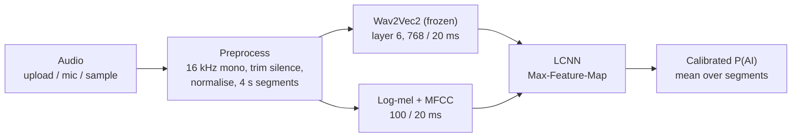

# FakeAudio Shield

**AI-generated voice and deepfake audio detection.** Record, upload or pick a sample, and the
app estimates whether the voice is real human speech or AI-generated, with a confidence score,
in about a second on a laptop CPU.

- **Measured results, per language:** see [RESULTS.md](RESULTS.md) (generated from the
  evaluation report) or the **Results** page in the app. No number in this README is typed by hand.
- **Demo script:** [DEMO.md](DEMO.md) · **Progress / open items:** [PROGRESS.md](PROGRESS.md)

## Quick start (Windows)

Prerequisites: Python 3.11+, Node.js 18+, `ffmpeg` on PATH (for M4A uploads).

```powershell
# one-time setup
cd backend
python -m venv .venv
.venv\Scripts\python -m pip install -r requirements.txt
cd ..\frontend
npm install
```

Run it with two double-clicks: **`start-backend.bat`** (wait for `Model ready`), then
**`start-frontend.bat`**, which opens http://localhost:5173. Or by hand:

```powershell
cd backend;  .venv\Scripts\python -m uvicorn app.main:app --port 8000     # terminal 1
cd frontend; npm run dev                                                   # terminal 2
```

The trained model is included (`backend/checkpoints/fakeaudio_lcnn.pt`), so no training is
needed for the demo. The microphone works on `http://localhost` (or https), not on a LAN IP.

## How it works



- **Pretrained model, adapted lightly:** Wav2Vec2 (`facebook/wav2vec2-base`, trained on 960 h
  of speech) is used frozen as a feature extractor. Only the small LCNN is trained, which
  is what makes CPU training feasible. Fine-tuning Wav2Vec2 itself needs a GPU.
- **Calibrated decision:** the cut-off is chosen on the **dev** set at the equal-error point
  (each language weighted equally). Scores are re-mapped so that cut-off reads as 50%.
  The test set is never used to choose anything.

## Data, cleaning and training

| Source | Role | Licence | Access |
|---|---|---|---|
| [ASVspoof 2019 LA](https://datashare.ed.ac.uk/handle/10283/3336) | English, real + AI (attacks A01–A19) | ODC-By 1.0 | open; balanced subset fetched via HTTP range requests |
| [Kathbath](https://huggingface.co/datasets/ai4bharat/Kathbath) (AI4Bharat) | Indian languages, **real** speech | CC BY 4.0 | gated: accept terms + `hf auth login` |
| [IndicSynth](https://huggingface.co/datasets/vdivyasharma/IndicSynth) | Indian languages, **AI** speech (XTTS-v2, FreeVC) | CC BY-NC 4.0 | open |

Only samples are downloaded, never the full datasets (7 GB to 845 GB). `prepare_dataset.py`
then applies the same rules to every language:
- removes exact duplicates (SHA-1), unreadable files, and clips shorter than 1 s or longer than 60 s
- checks that **no speaker appears in two splits** (no train/test leakage)
- balances real vs AI within every language and split
- only keeps a language if it has real **and** AI clips in train, dev and test

The result is `data/manifest.csv` plus `data/dataset_report.json`, which records every
removal reason. During training the loss is weighted so each (language, label) group counts
equally, so English, the largest language, cannot dominate.

**Reproduce everything** (downloads skip what is already on disk):

```powershell
cd backend
.venv\Scripts\python run_pipeline.py              # download -> clean -> train -> evaluate -> RESULTS.md
.venv\Scripts\python run_pipeline.py --skip-download
```

Individual steps: `fetch_asvspoof_subset.py`, `fetch_indic_subset.py --kind fake|real`,
`prepare_dataset.py`, `train.py` (`--proj-dim 128 --time-pool 1` for the original, slower
architecture), `evaluate.py` (re-score a checkpoint and calibrate its threshold),
`make_results_md.py`, and `data_size_study.py` (learning curve: how many clips are needed).

## Evaluation

Each language is evaluated separately on its own speaker-disjoint test set, with:
- **EER** (threshold-independent, with a 95% bootstrap CI)
- **accuracy**, **real-voice pass rate** and **AI catch rate** at the calibrated threshold, each with a 95% Wilson CI
- **sample and speaker counts**
- a breakdown by attack or generator

The English test set uses 13 voice generators (A07–A19) **never seen in training**.

Support status rule:
- **supported**: the upper 95% bound of test EER is ≤ 10%
- **experimental**: test EER ≤ 25%
- **not supported**: anything worse, or not evaluated

## Tests

```powershell
cd backend
.venv\Scripts\python -m pytest -q
```

The tests cover preprocessing (silence, too short, resampling, segmenting), corrupted files,
model shapes, manifest integrity (speaker-disjoint, balanced, no duplicates), and every API
status code (415, 400 empty/silent/corrupt, 200), plus known samples and the report schema.

## API

| Method | Path | Returns |
|---|---|---|
| GET | `/api/health` | model status and headline metrics |
| GET | `/api/report` | full evaluation report (per-language metrics, dataset, training) |
| GET | `/api/data-size-study` | learning-curve results |
| POST | `/api/predict` | multipart `file` (WAV/FLAC/MP3/OGG/M4A, ≤ 20 MB) → verdict, confidence, probabilities, per-segment scores |

Errors return `{"detail": "..."}`:
- **400:** empty, corrupt, silent, or under 0.5 s of speech
- **413:** file larger than 20 MB
- **415:** unsupported file type
- **503:** no trained model. The API never guesses.

## Limitations

- **Languages:** English, Hindi, Kannada, Tamil, Telugu and Malayalam are evaluated (see
  [RESULTS.md](RESULTS.md) for status per language). Marathi and Bengali have no data yet.
- **Small Indian test sets:** 32–104 clips and 3–22 speakers per language, so the
  confidence intervals are wide. A language needs at least 10 test speakers to be called
  "supported".
- **Recording conditions differ between the Indian sources:** real Kathbath speech is
  crowd-sourced phone and laptop audio, while IndicSynth is clean synthesis. A
  recording-condition-only check already reaches 12–24% EER there (versus 44% for English),
  so the near-perfect Indian scores are probably optimistic.
- **English is weaker in the multilingual model** (EER about 16%) than in an English-only
  model trained earlier (7.8%). Sharing a small classifier across six languages costs
  English accuracy.
- **Unseen generators:** they are the weak spot. Some ASVspoof attacks (for example A10)
  are mostly missed (see the per-attack table).
- **Recording conditions:** live microphone audio, phone calls, noise and music differ from the
  training data, so treat those results with extra caution.
- **A prediction, not proof:** the confidence is a calibrated model score, not a probability of fraud.

## Project structure

```
backend/   app/ (FastAPI: config, preprocess, features, model, inference, main)
           fetch_*.py, prepare_dataset.py, train.py, evaluate.py, run_pipeline.py,
           data_size_study.py, make_results_md.py, tests/, checkpoints/
frontend/  React + Vite: pages/Home.jsx, pages/Results.jsx, components/ (Checker,
           Recorder, AudioReview, charts, Info), lib/audio.js (raw mic -> WAV)
data/      downloaded audio, feature cache, manifest.csv, dataset_report.json (not in git)
```

## Team

Anitha M · Madiha Naz · Mallikarjun M B ·
Manjunath G K

**Guide:** Prof. Naveen Kumar B, Department of CSE, UBDT College of Engineering, Davangere
